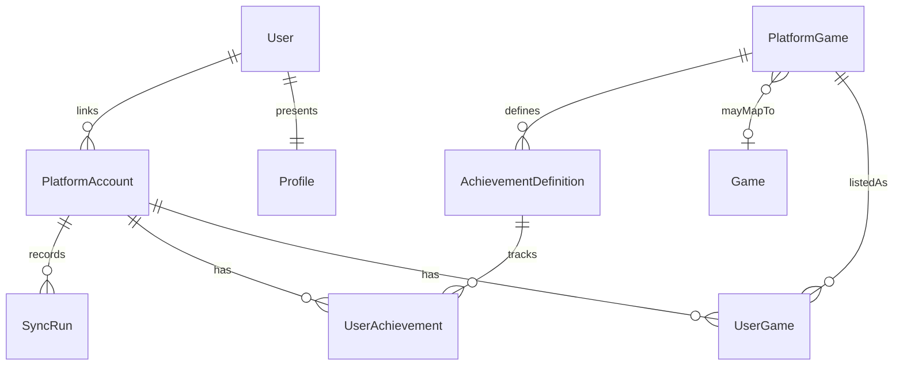

# Conceptual data model

This is the model to implement later. The Prisma schema in `apps/api/prisma/schema.prisma` intentionally has no domain models yet. The first migration should add the first real tables, not a speculative full schema.

Internal primary keys are UUIDs. External identifiers are strings and are unique only inside a platform scope. A Steam app id and a PlayStation title id are different namespaces. Store both as text.

## Entities

`User` is the GGCentral account. How that account authenticates is unresolved and out of scope.

`Profile` is the public gaming identity. The working assumption is one profile per user. Visibility rules are not decided.

`PlatformAccount` is a linked external identity. The stable key is `platform` plus `externalId`. Handle and display name can change and are not keys. The record stores link status and `lastSyncedAt`. Platform-only attributes that do not belong on every account stay in a metadata document.

`Game` is an optional canonical title. It is not required to show a library.

`PlatformGame` is the source of truth for a game on one platform: `platform` plus `externalGameId`, unique together. `canonicalGameId` is nullable. See [ADR 0005](../decisions/0005-platform-games-are-the-source-of-truth.md).

`UserGame` links a platform account to a platform game and is unique on that pair, so a repeated sync updates one row. `playtimeSeconds` and `lastPlayedAt` are nullable. Null means the platform did not supply the value. Zero means a real zero.

`AchievementDefinition` is platform-specific. It is unique on platform, platform game, and the platform's achievement id. PlayStation trophy groups stay in metadata. They are not modeled as a Steam concept.

`UserAchievement` is unique on platform account and achievement definition. `state` is `unknown`, `locked`, `in_progress`, or `unlocked`. `unknown` means the progress was not synchronized. It must not be stored as `locked`.

`SyncRun` records which slice was fetched (`profile`, `library`, or `achievements`), the status, and the timestamps. It does not store the raw response body.

## Unavailable data and empty data

- A missing sync run means the slice is unavailable.
- A successful sync that returns no games is an empty library.
- A null column means the field was absent.
- A present default, such as playtime `0` or state `locked`, means the platform reported that value.

## Provenance and idempotency

Synchronized rows carry `lastSyncedAt` or belong to a `SyncRun`. Upserts use the platform-scoped unique keys above so a repeated fetch does not create duplicates.

## Privacy and retention

Profiles, handles, and achievement progress are personal data. Disconnecting a platform, deleting an account, and how long any raw payload could be kept are product decisions. Raw platform responses are not stored in this model. Revisit that only with a retention limit and a reason to keep them.

PostgreSQL identifiers and timestamps do not by themselves make a record public. Public profile reads go through the API, which will have to enforce visibility once that decision exists.

## Open questions

These block the production schema:

- Authentication, and how a person proves ownership of a Steam or PlayStation account.
- Whether a user may link more than one account per platform. The recommended default is one, but it is not decided.
- Whether a profile is public, unlisted, or private, and which fields a visitor can see.
- What is deleted or retained when a platform is disconnected.
- Whether "library" means owned, played, or both. Steam and PlayStation do not answer that the same way.
- How, or whether, two platform editions become one canonical `Game`.
- Whether any raw payload is retained, for how long, and who can read it.
