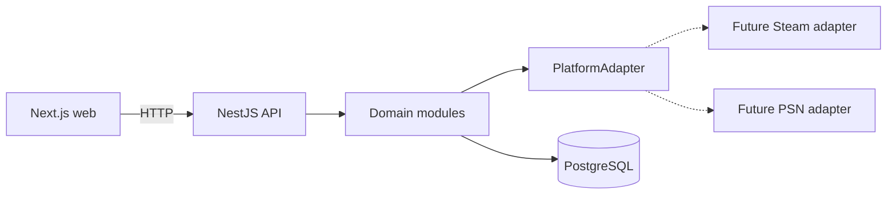

# Architecture overview

GGCentral is one NestJS API and one Next.js app. PostgreSQL is the only data store. The web app calls the API. It does not connect to the database.

## Components

| Component         | Responsibility                                                                                                   |
| ----------------- | ---------------------------------------------------------------------------------------------------------------- |
| `apps/web`        | Public profile UI, library and achievement presentation, and platform connection status. It owns rendering only. |
| `apps/api`        | Identity, connected accounts, catalog, library, achievements, and sync orchestration.                            |
| `apps/api/prisma` | Schema and migrations. The API is the only writer.                                                               |
| Platform adapters | Fetch and map one gaming platform into GGCentral snapshots.                                                      |
| PostgreSQL        | Durable storage for profiles and synchronized gaming data.                                                       |

The domain modules are a boundary map, not empty Nest modules. Add a module when it has behavior:

- `identity` — GGCentral users and public profiles
- `connections` — links to external platform accounts
- `catalog` — canonical games and platform-specific game records
- `library` — games a connected account owns or has played
- `achievements` — platform achievement definitions and user progress
- `sync` — ingestion runs and idempotent updates
- `integrations/steam` and `integrations/psn` — adapters, after the research gate in [integrations.md](integrations.md)

What exists today is the edge of that system: configuration, structured logging, error responses, OpenAPI, health checks, Prisma connectivity, and the `PlatformAdapter` port.

## Request path

1. The browser or a server component calls the API with `NEXT_PUBLIC_API_URL`.
2. Nest validates the environment at startup and validates HTTP inputs with Zod through `StandardSchemaValidationPipe`.
3. Controllers stay thin. Domain code will call a `PlatformAdapter` when it needs external data, then persist GGCentral records through Prisma.
4. Adapters return snapshots defined in `apps/api/src/integrations/platform-adapter.ts`. Vendor payloads stop at the adapter.

## Dependencies

- The web app depends on the API's HTTP contract.
- The API depends on PostgreSQL and, later, on outbound access to each platform.
- Domain code depends on the adapter port, not on a concrete platform.
- No service depends on Redis, a message broker, or another deployable.

Why the repository is a pnpm workspace without a shared package, why the API is a modular monolith, and why Prisma stays inside the API are recorded in [the decision records](../decisions).
